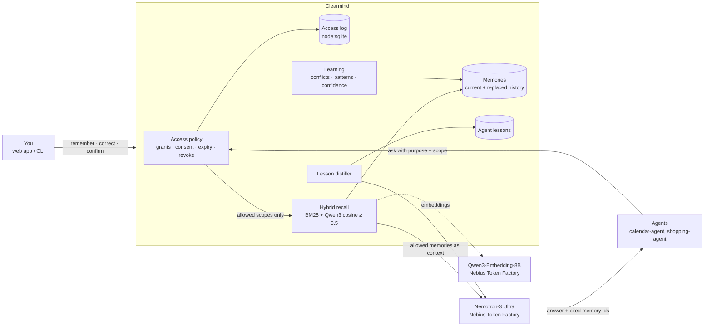

# Clearmind

**The memory layer you can see, correct and trust.**

AI assistants now remember things about you, but you can't see what they remember or fix it when it's wrong, and you can't control which agent reads what. Clearmind is a personal memory layer that makes memory *legible* and *governed*:

- **See it.** Every memory has tags, a confidence score and when it was learned.
- **Correct it.** A correction replaces the old version. The old version is kept as history, and recall only ever returns the current one, so stale facts can't come back.
- **Control it.** Agents read only through grants you consented to: which agent, which scopes (work, health…), for what purpose, until when. A purpose is required on every read, every attempt (allowed or denied) is logged, and you can revoke at any time.
- **Learn from it.** Clearmind spots **conflicts** (two flight times), **patterns** (3+ similar facts over 2+ days, shown with their evidence), and **agent lessons** that Nemotron distils from an agent's failed runs. Confidence rises when you confirm a fact and decays over time.

Track: **Personal AI** · Nebius × NVIDIA hackathon, Oct 2026.

## NVIDIA Nemotron on Nebius Token Factory

Clearmind's reasoning runs on Nebius Token Factory through its OpenAI-compatible API:

| Job | Model on Token Factory | Why |
|---|---|---|
| Answering from memory (`ask`, web "An agent asks") | `nvidia/Nemotron-3-Ultra-550b-a55b` | The strongest Nemotron on Token Factory. It answers **only** from memories the policy allowed and cites their ids (~0.8 s per answer). |
| Distilling agent lessons from failed runs | `nvidia/Nemotron-3-Ultra-550b-a55b` (via agentmemory's distiller) | Turns an agent's trace (tool calls and errors) into a reusable "when X, do Y" lesson. |
| Hybrid recall embeddings | `Qwen/Qwen3-Embedding-8B` | Cosine similarity blended 50/50 with BM25, with a minimum-similarity threshold of 0.5. |

You can override the model with `CLEARMIND_CHAT_MODEL` (for example `nvidia/nemotron-3-super-120b-a12b`). Every call is metered into `spend.jsonl` in the data directory, and a hard spend cap (`CLEARMIND_SPEND_CAP_USD`, default $1) stops calls before they go over. A full demo seed costs about **$0.002**.

## Architecture



The pieces:
- **agentmemory** (the library underneath) provides storage (SQLite), retrieval, the lesson distiller and supersession.
- **Clearmind** adds the user-facing memory model, the access policy, the learning layer, the Nebius wiring, the CLI and the web app.

## Setup

Requirements: Node ≥ 22.5 and pnpm. The repo expects `agentmemory` checked out next to it, on branch `hybrid-recall`.

```bash
git clone <clearmind> && cd clearmind
corepack pnpm install
corepack pnpm test                       # unit tests
# Keys live outside the repo. Load them per process:
#   NEBIUS_API_KEY=...   (in e.g. ~/.secrets/hackathon.env)
node --env-file=$HOME/.secrets/hackathon.env --import tsx scripts/seed.ts ./data   # realistic 14-day demo data
node --env-file=$HOME/.secrets/hackathon.env --import tsx src/cli.ts serve --dir ./data --owner tirth --port 8790
# open http://127.0.0.1:8790
```

Without a key, everything except `ask` and lesson distillation works offline: pass `--offline`, and recall falls back to BM25.

CLI: `remember, update, recall, list, history, confirm, conflicts, patterns, lessons, grant, grants, revoke, read, log, ask, serve`. Run `pnpm cli help` for usage.

## Demo flow (3 minutes)

1. **Correct a memory.** The standup moved from 10:00 to 11:30; the old version goes to "Corrected history".
2. **An agent asks without a purpose → DENIED** (and logged).
3. **Grant access with consent:** calendar-agent, scope `work`, purpose `schedule-meetings`, expires in 1 hour.
4. **The agent asks again → ALLOWED.** Nemotron answers "11:30 IST" and cites the memory; the log shows which memories it saw.
5. **Revoke → DENIED** again.
6. **What Clearmind learned:**
   - a flight-time conflict
   - patterns (paneer tikka, oat flat white, gym runs), each with evidence across days
   - a calendar-agent lesson: "convert to the participant's timezone".

## Benchmark

> _Placeholder: numbers are being produced tonight on public long-term-memory datasets (e.g. LongMemEval / LoCoMo subsets) by an independent benchmark harness._

Early internal check (stale-fact category, 16 queries), before → after supersession:

| Retriever | Newest version ranked first | An older version ranked above the newest |
|---|---|---|
| Hybrid (BM25 + Qwen3) | 0.44 → 0.63 | 0.44 → **0** |
| Embedding only | 0.25 → 0.63 | 0.63 → **0** |
| BM25 only | 0.25 → 0.38 | 0.38 → **0** |

## What was built during the hackathon

**Pre-existing ([agentmemory](https://github.com/tirthpatel002/agentmemory), by the same author):**
- SQLite store
- lexical and embedding retrievers
- OpenAI-compatible embedders
- the trace → lesson distiller, validator and merger

**Built during the hackathon:**
- In agentmemory:
  - **supersession** (`remember / supersede / current / history`, where recall skips replaced versions; branch `supersession`)
  - the **HybridRetriever** (BM25 + cosine; branch `hybrid-recall`)
- Clearmind itself, all of it:
  - the memory model with keys, confirmations and decaying confidence
  - the **access policy** (grants, consent, scopes, purposes, expiry, revoke, audit log)
  - the **learning layer** (conflict detection, pattern detection with evidence and a distinct-day rule, Nemotron lesson distillation for agents)
  - the **Nebius Token Factory integration** (Nemotron chat, Qwen3 embeddings, spend ledger with a hard cap)
  - the policy-enforced **`ask`**
  - the CLI, the web app and the demo seed

## Safety notes

- Keys are never stored in the repo. They are read from the environment only.
- The server binds to `127.0.0.1`.
- Memories are passed to the model as data. The system prompt tells Nemotron to treat them as data, not instructions.

License: MIT
